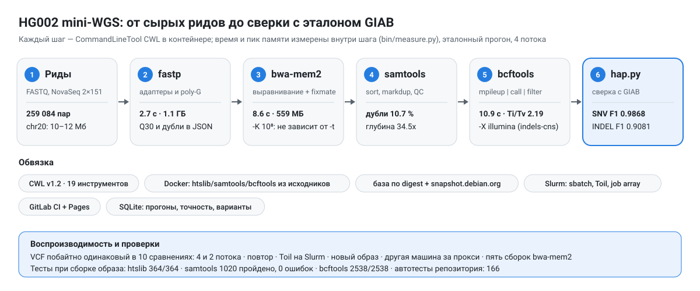
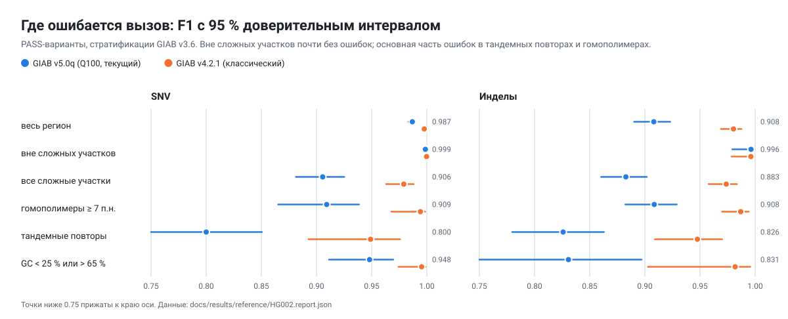
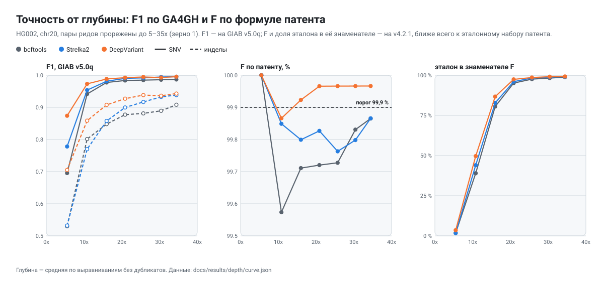

<p align="center">
  <picture>
    <source media="(prefers-color-scheme: dark)" srcset="docs/assets/pipeline-dark.svg">
    
  </picture>
</p>

<p align="center">
  <a href="https://github.com/KonkovDV/Etalon/actions/workflows/ci.yml"></a>
  
  
  
  
  <a href="LICENSE"></a>
</p>

# Etalon: пайплайны WGS и RNA-seq со сверкой с эталонными образцами

Сайт проекта с отчётами и документацией: https://konkovdv.github.io/Etalon/ · [справка на одну страницу](docs/SPRAVKA.md) · [English version](README.en.md)

Для работодателя: [соответствие вакансии «Биоинформатик-программист»](docs/VACANCY.md) · [план усиления производственного пайплайна](docs/IMPROVEMENTS.md) · [словарь терминов](docs/GLOSSARY.md) · [черновик статьи](docs/paper/ARTICLE.md) · [тезисы доклада](docs/paper/ABSTRACT.md)

Открытый проект о проверке пайплайнов секвенирования на эталонных образцах. WGS сверяется с образцом GIAB HG002 (NIST), RNA-seq — со spike-in ERCC, у которых известна концентрация каждого транскрипта. Точность считается с 95 % интервалами и отдельно по типам участков генома. Прогоны воспроизводятся побайтно, числа в текстах сверяются с данными в CI.

Шаги описаны на CWL v1.2, программы работают в Docker-образах, закреплённых по digest; htslib, samtools, bcftools, featureCounts и fastp собираются из исходников вместе со своими тестами. Запуск — cwltool, Toil или Slurm, проверки — GitHub Actions и GitLab CI.

Данные WGS — участок хромосомы 20 длиной 2 Мб с генами *SNAP25*, *MKKS* и *JAG1*, прочитанный на NovaSeq 6000 (2×151, ~35x, PCR-free). На одном BAM работают три вызывателя: bcftools, Strelka2 и DeepVariant. RNA-seq — эталонные РНК UHR и HBR, по три реплики. Прогон WGS занимает около минуты, поэтому его можно повторять на каждый коммит.

Рядом с точностью проверены задачи популяционной геномики: метрика приёмки по патенту RU 2846268 на разной глубине, запись одних и тех же вариантов разными программами и знаменатель частоты (AN) для базы популяционных частот.

## Коротко

| Показатель | Значение | Источник |
|---|---|---|
| Точность | SNV F1 **<!--ev:snp_v5_f1-->0.9868<!--/ev-->**, инделы F1 **<!--ev:indel_v5_f1-->0.9081<!--/ev-->** на текущем эталоне GIAB v5.0q, с 95 % интервалами | [C-01](CLAIMS_REGISTRY.md), [отчёт](docs/results/reference/HG002.report.md) |
| Где ошибки | в тандемных повторах и гомополимерах; вне сложных участков SNV F1 <!--ev:snp_v5_easy_f1-->0.999<!--/ev--> | [C-03](CLAIMS_REGISTRY.md), [RESULTS](docs/RESULTS.md) |
| Вызыватели | на одном BAM Strelka2 (производственный выбор популяционных проектов) точнее bcftools: SNV F1 <!--ev:strelka2_snp_v5_f1-->0.9955<!--/ev-->, инделы <!--ev:strelka2_indel_v5_f1-->0.9383<!--/ev-->; DeepVariant не отличается от Strelka2 по F1 и тратит в <!--ev:dv_vs_strelka2_cpu_x-->8.6<!--/ev--> раза больше CPU | [C-16](CLAIMS_REGISTRY.md), [C-17](CLAIMS_REGISTRY.md), [PRODUCTION](docs/PRODUCTION.md) |
| Метрика приёмки | формула патента RU 2846268 рядом с GA4GH: порог 99,9 % на v4.2.1 проходит <!--ev:patent_pass_v421-->1<!--/ev--> вызыватель из трёх, на v5.0q — <!--ev:patent_pass_v5-->0<!--/ev-->; пропуски и лишние вызовы в F не входят | [C-19](CLAIMS_REGISTRY.md), [METRICS](docs/METRICS.md) |
| Глубина | риды прорежены до 5–35x: на <!--ev:depth_f145_x-->5.5<!--/ev-->x F = 100 % у всех трёх вызывателей, потому что в знаменатель попадает <!--ev:depth_f145_bcftools_share_v421-->1.8<!--/ev-->–<!--ev:depth_f145_dv_share_v421-->3.5<!--/ev--> % эталона; разброс F между повторами на одной глубине — до <!--ev:depth_rep_f290_bcftools_f_v421_span-->0.28<!--/ev--> п. п. | [C-27](CLAIMS_REGISTRY.md), [METRICS](docs/METRICS.md#f-и-глубина) |
| База частот | <!--ev:repr_share_min-->17<!--/ev-->–<!--ev:repr_share_max-->53<!--/ev--> % различий между вызывателями по ключу (CHROM, POS, REF, ALT) — запись, а не разные варианты; <!--ev:repr_loci_total-->16<!--/ev--> случаев «тот же гаплотип» перепроверены сборкой из референса. AN по gVCF: в когорте разной глубины AF гетерозигот <!--ev:cohort_all_het_honest-->0.496<!--/ev--> против <!--ev:cohort_all_het_naive-->0.475<!--/ev--> при AN = 2N | [C-28](CLAIMS_REGISTRY.md), [C-29](CLAIMS_REGISTRY.md), [AGGREGATION](docs/AGGREGATION.md) |
| RNA-seq | STAR + featureCounts против ERCC: наклон <!--ev:rnaseq_slope_min-->0.94<!--/ev-->–<!--ev:rnaseq_slope_max-->0.99<!--/ev--> при теоретической 1, R² ≥ <!--ev:rnaseq_r2_min-->0.966<!--/ev-->, кратность 4 : 1, 1 : 1, 2 : 3 и 1 : 2 с корреляцией <!--ev:rnaseq_fc_pearson-->0.984<!--/ev-->; счёты побайтно одинаковые при 4 и 2 потоках | [C-21](CLAIMS_REGISTRY.md), [C-22](CLAIMS_REGISTRY.md), [RNASEQ](docs/RNASEQ.md) |
| Воспроизводимость | VCF совпадает побайтно во всех <!--ev:repro_comparisons-->10<!--/ev--> сравнениях: другое число потоков, повторный запуск, Toil на Slurm, образ, пересобранный с нуля, другая машина за прокси, пять сборок bwa-mem2 под разные процессоры | [C-06](CLAIMS_REGISTRY.md), [REPRODUCIBILITY](docs/REPRODUCIBILITY.md) |
| Время и память | шаги вместе — <!--ev:total_wall_s-->40<!--/ev--> с, самый тяжёлый шаг — <!--ev:max_peak_rss_mb-->1138<!--/ev--> МБ; замер внутри каждого шага | [C-10](CLAIMS_REGISTRY.md), [отчёт](docs/results/reference/HG002.report.md#ресурсы-по-шагам) |
| Хранение | CRAM 3.1 занимает <!--ev:cram_v31_share-->29<!--/ev--> % объёма BAM, без потерь: записи и вызовы bcftools из CRAM те же; на <!--ev:cram_cohort-->100 000<!--/ev--> геномов 30x разница порядка <!--ev:cram_saving_v31_pb-->2.4<!--/ev--> ПБ (грубая оценка) | [C-30](CLAIMS_REGISTRY.md), [PRODUCTION](docs/PRODUCTION.md#хранение-выравниваний-cram-вместо-bam) |
| Найденные ошибки | <!--ev:debug_cases-->23<!--/ev--> случая, от теста htslib за прокси до гистограммы вставки в fastp, которую считает один поток из N (с патчем и проверкой) | [DEBUGGING](docs/DEBUGGING.md), [C-26](CLAIMS_REGISTRY.md) |
| Не входит | полный геном, GATK, DRAGEN, тест дифференциальной экспрессии | [LIMITS](LIMITS.md) |

## Результат

<p align="center">
  <picture>
    <source media="(prefers-color-scheme: dark)" srcset="docs/assets/accuracy-dark.svg">
    
  </picture>
</p>

| Эталон | SNV F1 [95 % ДИ] | Инделы F1 [95 % ДИ] | Почему такие числа |
|---|---|---|---|
| GIAB v5.0q (по сборке T2T-Q100, текущий) | <!--ev:snp_v5_f1-->0.9868<!--/ev--> [<!--ev:snp_v5_f1_ci-->0.983–0.990<!--/ev-->] | <!--ev:indel_v5_f1-->0.9081<!--/ev--> [<!--ev:indel_v5_f1_ci-->0.890–0.923<!--/ev-->] | эталон включает сложные участки, на них ошибок больше |
| GIAB v4.2.1 (прежний) | <!--ev:snp_v421_f1-->0.9977<!--/ev--> [<!--ev:snp_v421_f1_ci-->0.996–0.999<!--/ev-->] | <!--ev:indel_v421_f1-->0.9804<!--/ev--> [<!--ev:indel_v421_f1_ci-->0.969–0.988<!--/ev-->] | многие сложные участки в него не вошли |

Что из этого следует (подробно — в [аналитическом отчёте](docs/RESULTS.md)):

1. От эталона оценка зависит не меньше, чем от модели вызова. Одни и те же вызовы на v4.2.1 и v5.0q расходятся по F1 инделов на 7 п.п., а NIST уже считает v4.2.1 для HG002 устаревшим. Поэтому в любой оценке точности нужно называть эталон и его версию.
2. Модель инделов bcftools ≥ 1.20 (`-X illumina`) поднимает F1 инделов с <!--ev:indel_v5_f1_legacy-->0.8399<!--/ev--> до <!--ev:indel_v5_f1-->0.9081<!--/ev-->. Интервалы не пересекаются, SNV не меняются ([C-04](CLAIMS_REGISTRY.md)).
3. Почти все ошибки — в сложных участках: в тандемных повторах SNV F1 <!--ev:snp_v5_tr_f1-->0.800<!--/ev-->, вне сложных участков <!--ev:snp_v5_easy_f1-->0.999<!--/ev-->. Средняя точность по геному зависит от того, сколько в нём таких участков.

### Метрика приёмки и глубина

<p align="center">
  <picture>
    <source media="(prefers-color-scheme: dark)" srcset="docs/assets/depth-dark.svg">
    
  </picture>
</p>

Метрика F из патента RU 2846268 посчитана рядом с GA4GH на тех же вызовах и на ридах, прореженных до 5–35x. F проверяет генотипы там, где вызов совпал с эталоном, и на малой глубине растёт: на <!--ev:depth_f145_x-->5.5<!--/ev-->x она равна 100 % у всех трёх вызывателей, потому что в знаменатель попадает <!--ev:depth_f145_bcftools_share_v421-->1.8<!--/ev-->–<!--ev:depth_f145_dv_share_v421-->3.5<!--/ev--> % эталона. Поэтому рядом с F стоит показывать эту долю или recall ([METRICS](docs/METRICS.md#f-и-глубина)).

Полный отчёт с графиками — [`HG002.report.html`](docs/results/reference/HG002.report.html). Это один HTML-файл без внешних зависимостей, он открывается локально; в CI его публикуют в Pages.

## Запуск

Нужны Docker, Python ≥ 3.9 и около 2 ГБ места.

```bash
make setup && source .venv/bin/activate   # cwltool в venv
```

```bash
make image   # образ: htslib/samtools/bcftools из исходников + их тесты, ~3 мин
```

```bash
make data    # HG002 chr20:10–12 Мб, эталоны GIAB, стратификации; ~45 с, проверка sha256/MD5
```

```bash
make run     # пайплайн + отчёт + порог качества -> results/run/HG002.report.html
```

```bash
make repro   # два прогона (4 и 2 потока) и побайтное сравнение VCF/BAM/hap.py
```

```bash
make callers # Strelka2 и DeepVariant на том же BAM -> results/callers/compare.md
```

```bash
make metric  # формула патента RU 2846268 рядом с GA4GH -> results/metrics/patent_metric.md
```

```bash
make rnaseq-image rnaseq-data rnaseq   # RNA-seq: образ, данные UHR/HBR с ERCC, прогон -> results/rnaseq/rnaseq.report.md
```

```bash
make depth aggregation   # серия 5–35x и проверки для базы частот -> docs/results/depth, docs/results/aggregation
```

```bash
make fastp-isize-image fastp-isize   # fastp 1.4.0 как есть и с патчем гистограммы вставки на 1–4 потоках
```

```bash
make cram    # BAM против CRAM 3.0, 3.1 и 3.1 archive: размер, время, вызовы -> docs/results/cram
```

За корпоративным прокси с собственным корневым сертификатом: `make image data EXTRA_CA=/path/to/root.pem`, подробности — в [OFFLINE](docs/OFFLINE.md).

На кластере: `sbatch slurm/run_cwltool_apptainer.sbatch` запускает весь пайплайн на одном узле, `sbatch slurm/run_toil_slurm.sbatch` отправляет каждый шаг отдельной задачей Slurm, `slurm/array_cohort.sbatch` обрабатывает таблицу образцов массивом задач. Подробности — в [CLUSTER](docs/CLUSTER.md), список всех команд — `make help`.

## Как применить к своим данным

Эталон, референс и образцы задаются в job-файле, код CWL при этом не меняется.

| Что нужно | Что поменять |
|---|---|
| другой эталонный образец (HG001–HG007, национальный эталон) | `truth_names`, `truth_vcfs`, `truth_beds`; эталонов может быть несколько, hap.py пройдёт по каждому |
| другой референс | `reference`: индексы bwa-mem2 и `.fai` пайплайн строит сам. Для перевода VCF и BED между координатами есть `scripts/shift_coords.py` |
| свои участки для разбора ошибок | каталог `stratification` с `strata.tsv` и BED-файлами |
| когорта без эталона | таблица образцов и `slurm/array_cohort.sbatch`: сверка с эталоном пропускается, вызовы загружаются в SQLite, где считаются AC/AN/AF |
| свои пороги приёмки | `config/qc_thresholds.json`; как их откалибровать, написано в [METHODOLOGY](docs/METHODOLOGY.md#порог-качества) |

## Как устроено

| Шаг | Инструмент | Что делает и почему так |
|---|---|---|
| 1 | fastp 1.4.0 | срезает адаптеры по перекрытию пары и хвосты poly-G: на двухцветной химии NovaSeq отсутствие сигнала читается как G с высоким качеством. Скользящей обрезки по качеству нет, с плохими концами справляются выравниватель и вызыватель |
| 2 | bwa-mem2 2.3 → samtools fixmate | `-K 10⁸` делает выравнивание независимым от числа потоков; `-Y` — мягкая обрезка дополнительных выравниваний |
| 3 | samtools sort, markdup | `-d 2500` для оптических дубликатов на ячейке с нанолунками (patterned flow cell); оптические и библиотечные дубликаты считаются отдельно |
| 4 | bcftools mpileup / call / norm / filter | `-X illumina` (consensus-based вызов инделов), `-q20 -Q20`, нормализация инделов, мягкий фильтр `LowQual` |
| 5 | hap.py 0.3.15 | сверка с GIAB v5.0q и v4.2.1 параллельно, по 8 стратификациям GIAB v3.6 |
| 6 | отчёт | интервалы Уилсона и Монте-Карло для F1, глубина против Пуассона и отрицательного биномиального, тест Фишера на 8-oxoG, ресурсы шагов |

RNA-seq идёт так же: fastp → STAR 2.7.11b (выравнивание и счёт по генам) → featureCounts (Subread, из исходников с тестами) → отчёт со сверкой по ERCC.

Каждый шаг запускается через `bin/measure.py`. Он записывает время, CPU и пик памяти всего дерева процессов в JSON, и этот файл становится обычным выходом CWL под любым движком ([ADR-003](docs/adr/ADR-003-measure-inside-step.md)).

```text
cwl/tools/          CommandLineTool: шаги WGS и RNA-seq, отчёты, Strelka2, DeepVariant, очистка заголовка VCF
cwl/workflows/      mini-wgs.cwl — WGS; call-strelka2.cwl, call-deepvariant.cwl — вызов на готовом BAM; rnaseq.cwl — RNA-seq
cwl/jobs/           job-файлы для данных из `make data` и `make rnaseq-data`
docker/tools/       Dockerfile: сборка из исходников, digest + snapshot.debian.org
docker/rnaseq/      Dockerfile RNA-seq: STAR, featureCounts из исходников с тестами
docker/fastp-isize/ fastp 1.4.0 из исходников как есть и с патчем гистограммы длины вставки
bin/measure.py      замер ресурсов шага (Python 2.7 и 3: работает и в образе hap.py)
scripts/            подготовка данных, запуск, отчёт, сверка, база результатов, сайт
slurm/              sbatch: один узел / Toil / массив по когорте; сборка .sif
config/             описание набора данных и пороги качества
tests/              автотесты: статистика, координаты, замер, правила CWL, отчёты, сайт
docs/               методика, результаты, отладка, кластер, ADR, литература
```

## Документация

- [VACANCY](docs/VACANCY.md) — каждое требование вакансии «Биоинформатик-программист» и его подтверждение в проекте; [GLOSSARY](docs/GLOSSARY.md) — словарь терминов
- [SPRAVKA](docs/SPRAVKA.md) — справка на одну страницу: цель, материалы, результаты, выводы, предложения
- [Черновик статьи](docs/paper/ARTICLE.md) и [тезисы доклада](docs/paper/ABSTRACT.md)
- [METHODOLOGY](docs/METHODOLOGY.md) — почему выбраны эти данные, инструменты, параметры и статистика
- [RESULTS](docs/RESULTS.md) — аналитический отчёт: точность, страты, эксперимент, ресурсы, вызыватели
- [PRODUCTION](docs/PRODUCTION.md) — производственный стек популяционного WGS (DRAGEN → Strelka2) и что из него воспроизведено
- [METRICS](docs/METRICS.md) — метрика приёмки из патента RU 2846268 рядом с GA4GH: что видит каждая и как ведёт себя на разной глубине
- [AGGREGATION](docs/AGGREGATION.md) — база частот: один вариант в записи разных программ и AN по gVCF
- [RNASEQ](docs/RNASEQ.md) — RNA-seq: STAR и featureCounts, сверка с ERCC, реплики, маркерные гены, воспроизводимость
- [REPRODUCIBILITY](docs/REPRODUCIBILITY.md) — откуда берётся недетерминизм и что сделано с каждым источником
- [DEBUGGING](docs/DEBUGGING.md) — журнал отладки
- [CLUSTER](docs/CLUSTER.md) · [GITLAB](docs/GITLAB.md) — Slurm, Apptainer, Toil; зеркало в GitLab и CI
- [OFFLINE](docs/OFFLINE.md) — закрытый контур: прокси с подменой TLS, свой корневой сертификат, внутренние зеркала
- [ADR](docs/adr/) — архитектурные решения · [LITERATURE](docs/LITERATURE.md) — источники
- [CLAIMS_REGISTRY](CLAIMS_REGISTRY.md) · [LIMITS](LIMITS.md) · [PROVENANCE](PROVENANCE.md) — утверждения, границы, происхождение данных и программ

Документы и HTML-отчёт также собираются в сайт для GitLab Pages и GitHub Pages (`scripts/build_site.py`). Перед публикацией сайт проверяется в браузере на 8 устройствах в светлой и тёмной теме и на соответствие WCAG 2.2 AA (`scripts/check_site.js`).

Числа в этом README помечены и в CI сверяются с `evidence.json` (`scripts/lint_claims.py`). Если данные или код изменятся, проверка не пройдёт, пока число в тексте не обновят.

## Лицензия

MIT. Данные GIAB принадлежат NIST и находятся в общественном достоянии; риды WGS взяты из публичного набора DeepVariant case study, риды RNA-seq — из открытого учебного набора Griffith et al. (2015), концентрации ERCC — из документа Thermo Fisher. Как цитировать — [CITATION.cff](CITATION.cff).
