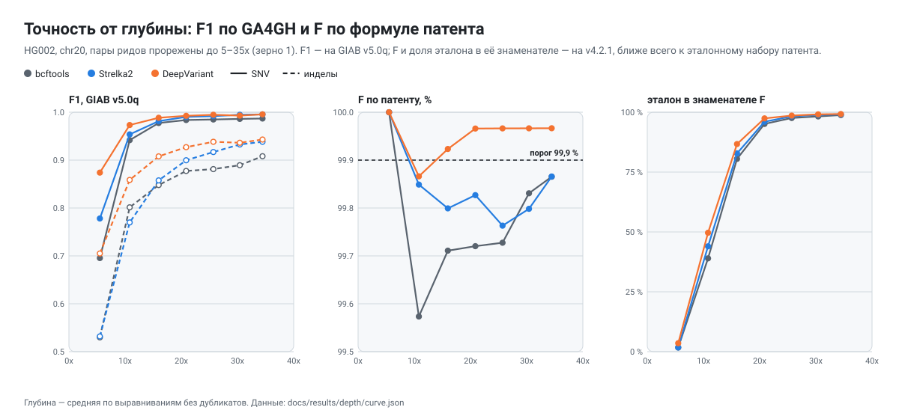

# Метрика приёмки: согласие генотипов (RU 2846268) и GA4GH

Когда пайплайн проверяют по эталонному образцу, задают два разных вопроса. Первый — верен ли генотип там, где вызов совпал с эталоном. Второй — сколько эталонных вариантов найдено, сколько вызовов лишние и в каких участках генома ошибки. Метрика F из патента RU 2846268 отвечает на первый вопрос, стандарт GA4GH (hap.py, Krusche et al., 2019) — на второй. Здесь обе посчитаны на одних и тех же вызовах, чтобы было видно, что даёт каждая.

## Две метрики

**F (патент RU 2846268).** Доля вызовов с правильным генотипом среди вызовов, совпавших с эталоном точно по CHR, POS, REF и ALT. В расчёт входят только вызовы с FILTER = PASS, GQ > 10 и sum(AD) > 10. Протокол пригоден, если F > 99,9 %.

**GA4GH.** Recall = TP / (TP + FN), precision = TP / (TP + FP), F1 — их гармоническое среднее. Вызовы сравниваются с эталоном по гаплотипам, поэтому одинаковые варианты, записанные по-разному, совпадают. Метрики считаются по стратам GIAB, в Etalon — с 95 % интервалами ([METHODOLOGY](METHODOLOGY.md#статистика)).

Чего F не видит по построению (это проверяют тесты `tests/test_concordance.py`):

- **пропуски**: эталонный вариант без вызова не входит ни в числитель, ни в знаменатель;
- **лишние вызовы**: вызов, которого нет в эталоне, тоже никуда не входит;
- **другую запись того же варианта**: если индел или мультиаллельная позиция записаны не так, как в эталоне, вызов выпадает из знаменателя, хотя ошибки нет.

## Реализация

`scripts/concordance.py` считает F тремя способами:

- **как в патенте** — ключ (CHR, POS, REF, ALT) берётся из VCF как есть;
- **после разбиения** — мультиаллельные записи разбиты на двуаллельные;
- **после нормализации** — разбиение плюс сдвиг инделов влево по референсу (Tan et al., 2015), то же делает `bcftools norm -m -any -f ref`. Эта нормализация сверена с bcftools на <!--ev:norm_check_records-->17759<!--/ev--> записях пяти VCF, расхождений <!--ev:norm_check_diff-->0<!--/ev--> ([проверка](results/metrics/normalization_check.md)).

У bcftools нет поля GQ, поэтому GQ считается как разность двух наименьших PL, как в GATK. Генотип сравнивается без учёта фазы. Учитываются варианты и вызовы внутри доверенных участков эталона.

## Результаты

HG002, ~35x, 2 Мб chr20, те же PASS-вызовы, что в [сравнении вызывателей](PRODUCTION.md#что-показало-сравнение-вызывателей). Полные таблицы — в [results/metrics/patent_metric.md](results/metrics/patent_metric.md).

| Вызыватель | F, % на v4.2.1 | F, % на v5.0q | F, % на v5.0q вне сложных участков | F, % на v5.0q в сложных участках | Инделы F1 на v5.0q |
|---|---|---|---|---|---|
| bcftools | <!--ev:patent_f_v421_bcftools-->99.87<!--/ev--> | <!--ev:patent_f_v5_bcftools-->99.55<!--/ev--> | <!--ev:patent_f_v5_bcftools_easy-->99.96<!--/ev--> | <!--ev:patent_f_v5_bcftools_difficult-->98.26<!--/ev--> | <!--ev:bcftools_indel_v5_f1-->0.9081<!--/ev--> |
| Strelka2 | <!--ev:patent_f_v421_strelka2-->99.87<!--/ev--> | <!--ev:patent_f_v5_strelka2-->99.74<!--/ev--> | <!--ev:patent_f_v5_strelka2_easy-->99.88<!--/ev--> | <!--ev:patent_f_v5_strelka2_difficult-->98.70<!--/ev--> | <!--ev:strelka2_indel_v5_f1-->0.9383<!--/ev--> |
| DeepVariant | <!--ev:patent_f_v421_dv-->99.97<!--/ev--> | <!--ev:patent_f_v5_dv-->99.84<!--/ev--> | <!--ev:patent_f_v5_dv_easy-->100.00<!--/ev--> | <!--ev:patent_f_v5_dv_difficult-->99.09<!--/ev--> | <!--ev:dv_indel_v5_f1-->0.9430<!--/ev--> |

F в первых двух столбцах посчитана как в патенте, в стратах — после нормализации.

## Что из этого следует

1. Порог зависит от эталона. На v4.2.1 порог 99,9 % проходит <!--ev:patent_pass_v421-->1<!--/ev--> вызыватель из трёх, на v5.0q — <!--ev:patent_pass_v5-->0<!--/ev-->. Вне сложных участков F близка к 100 %, в сложных она ниже примерно на 1–2 п. п. Эталонный набор из патента собран из вариантов, которые прошли фильтры по глубине и качеству и совпали во всех повторах, а плохо картируемые участки из него исключены. Значит, порог 99,9 % откалиброван под такой набор: на эталон со сложными участками его нельзя переносить без новой калибровки.
2. На этих данных F и F1 ранжируют вызыватели одинаково. Но F1 показывает, из чего складывается разница: у bcftools <!--ev:bcftools_indel_v5_fn-->60<!--/ev--> пропущенных и <!--ev:bcftools_indel_v5_fp-->50<!--/ev--> лишних инделов, и ни один из них в F не входит. Пайплайн, который стал пропускать больше вариантов, F не ухудшит.
3. Запись вариантов меняет знаменатель, почти не меняя F. В доверенных участках v5.0q <!--ev:patent_truth_multi_v5-->84<!--/ev--> мультиаллельные записи эталона. При точном сравнении без разбиения они почти не совпадают с вызовами: после разбиения знаменатель у bcftools растёт с <!--ev:patent_lit_den_v5_bcftools-->3108<!--/ev--> до <!--ev:patent_norm_den_v5_bcftools-->3192<!--/ev-->, у Strelka2 — с <!--ev:patent_lit_den_v5_strelka2-->3124<!--/ev--> до <!--ev:patent_norm_den_v5_strelka2-->3216<!--/ev-->. Сдвиг инделов влево добавил <!--ev:patent_left_shift_gain-->0<!--/ev--> записей: и вызыватели, и GIAB уже пишут инделы сдвинутыми влево. В эталонном наборе патента мультиаллельных позиций нет (не больше одной альтернативной аллели), поэтому там та же проблема возникает со стороны вызовов: мультиаллельная запись вызывателя не совпадёт с двуаллельной записью эталона. Если сравнивать вызовы разных программ или собирать их в одну базу частот, разбиение и нормализация нужны до точного сравнения ключей.

## F и глубина

Новый протокол пробоподготовки почти всегда даёт и другую глубину, поэтому сначала надо понять, как F зависит от одной только глубины. Риды HG002 прорежены до 5–35x, и на каждой глубине заново прогнаны весь пайплайн и три вызывателя (`make depth`, около получаса на 4 потоках). `samtools view -s` оставляет или выбрасывает пару целиком по хэшу имени рида, поэтому одно зерно даёт одну и ту же выборку на любой машине. Основная серия — <!--ev:depth_points-->7<!--/ev--> точек с зерном 1, от <!--ev:depth_min_x-->5.5<!--/ev-->x до <!--ev:depth_max_x-->34.5<!--/ev-->x. На ~10x и ~21x добавлены зёрна 2 и 3: по ним видно, сколько меняется только от того, какие риды попали в выборку. Полные таблицы с интервалами — в [results/depth/curve.md](results/depth/curve.md).

  <picture>
    <source media="(prefers-color-scheme: dark)" srcset="assets/depth-dark.svg">
    
  </picture>

| Глубина | SNV F1 на v5.0q | F на v4.2.1, % | Эталона в знаменателе F, % (v4.2.1) |
|---|---|---|---|
| <!--ev:depth_f1000_x-->34.5<!--/ev-->x | <!--ev:depth_f1000_bcftools_snp_f1-->0.987<!--/ev--> / <!--ev:depth_f1000_strelka2_snp_f1-->0.995<!--/ev--> / <!--ev:depth_f1000_dv_snp_f1-->0.996<!--/ev--> | <!--ev:depth_f1000_bcftools_f_v421-->99.87<!--/ev--> / <!--ev:depth_f1000_strelka2_f_v421-->99.87<!--/ev--> / <!--ev:depth_f1000_dv_f_v421-->99.97<!--/ev--> | <!--ev:depth_f1000_bcftools_share_v421-->98.8<!--/ev--> / <!--ev:depth_f1000_strelka2_share_v421-->99.1<!--/ev--> / <!--ev:depth_f1000_dv_share_v421-->99.2<!--/ev--> |
| <!--ev:depth_f580_x-->20.9<!--/ev-->x | <!--ev:depth_f580_bcftools_snp_f1-->0.984<!--/ev--> / <!--ev:depth_f580_strelka2_snp_f1-->0.990<!--/ev--> / <!--ev:depth_f580_dv_snp_f1-->0.992<!--/ev--> | <!--ev:depth_f580_bcftools_f_v421-->99.72<!--/ev--> / <!--ev:depth_f580_strelka2_f_v421-->99.83<!--/ev--> / <!--ev:depth_f580_dv_f_v421-->99.97<!--/ev--> | <!--ev:depth_f580_bcftools_share_v421-->95.1<!--/ev--> / <!--ev:depth_f580_strelka2_share_v421-->96.0<!--/ev--> / <!--ev:depth_f580_dv_share_v421-->97.4<!--/ev--> |
| <!--ev:depth_f435_x-->16.0<!--/ev-->x | <!--ev:depth_f435_bcftools_snp_f1-->0.977<!--/ev--> / <!--ev:depth_f435_strelka2_snp_f1-->0.981<!--/ev--> / <!--ev:depth_f435_dv_snp_f1-->0.988<!--/ev--> | <!--ev:depth_f435_bcftools_f_v421-->99.71<!--/ev--> / <!--ev:depth_f435_strelka2_f_v421-->99.80<!--/ev--> / <!--ev:depth_f435_dv_f_v421-->99.92<!--/ev--> | <!--ev:depth_f435_bcftools_share_v421-->80.5<!--/ev--> / <!--ev:depth_f435_strelka2_share_v421-->82.8<!--/ev--> / <!--ev:depth_f435_dv_share_v421-->86.7<!--/ev--> |
| <!--ev:depth_f290_x-->10.8<!--/ev-->x | <!--ev:depth_f290_bcftools_snp_f1-->0.942<!--/ev--> / <!--ev:depth_f290_strelka2_snp_f1-->0.954<!--/ev--> / <!--ev:depth_f290_dv_snp_f1-->0.973<!--/ev--> | <!--ev:depth_f290_bcftools_f_v421-->99.57<!--/ev--> / <!--ev:depth_f290_strelka2_f_v421-->99.85<!--/ev--> / <!--ev:depth_f290_dv_f_v421-->99.87<!--/ev--> | <!--ev:depth_f290_bcftools_share_v421-->39.0<!--/ev--> / <!--ev:depth_f290_strelka2_share_v421-->44.0<!--/ev--> / <!--ev:depth_f290_dv_share_v421-->49.7<!--/ev--> |
| <!--ev:depth_f145_x-->5.5<!--/ev-->x | <!--ev:depth_f145_bcftools_snp_f1-->0.695<!--/ev--> / <!--ev:depth_f145_strelka2_snp_f1-->0.778<!--/ev--> / <!--ev:depth_f145_dv_snp_f1-->0.874<!--/ev--> | <!--ev:depth_f145_bcftools_f_v421-->100.00<!--/ev--> / <!--ev:depth_f145_strelka2_f_v421-->100.00<!--/ev--> / <!--ev:depth_f145_dv_f_v421-->100.00<!--/ev--> | <!--ev:depth_f145_bcftools_share_v421-->1.8<!--/ev--> / <!--ev:depth_f145_strelka2_share_v421-->1.8<!--/ev--> / <!--ev:depth_f145_dv_share_v421-->3.5<!--/ev--> |

В ячейках — bcftools / Strelka2 / DeepVariant, зерно 1. F1 — на v5.0q, F — на v4.2.1: этот эталон ближе к эталонному набору патента, из которого сложные участки исключены.

1. На 5,5x все три вызывателя проходят порог, и F у всех равна 100 %. SNV F1 при этом от <!--ev:depth_f145_bcftools_snp_f1-->0.695<!--/ev--> до <!--ev:depth_f145_dv_snp_f1-->0.874<!--/ev-->. Дело в фильтре sum(AD) > 10: при средней глубине 5,5x его проходят только позиции, где ридов случайно вдвое больше среднего. В знаменатель F попадают <!--ev:depth_f145_bcftools_den_v421-->53<!--/ev-->–<!--ev:depth_f145_dv_den_v421-->106<!--/ev--> вариантов, то есть <!--ev:depth_f145_bcftools_share_v421-->1.8<!--/ev-->–<!--ev:depth_f145_dv_share_v421-->3.5<!--/ev--> % эталона. F отвечает на вопрос, верен ли генотип там, где данных хватает, но не говорит, много ли таких мест. Если рядом с F не стоит доля эталона в знаменателе или recall, «годен» получат и данные с SNV F1 <!--ev:depth_f145_bcftools_snp_f1-->0.695<!--/ev-->.
2. Между 10x и 35x F меняется на десятые доли процента, F1 — сильнее. У bcftools на v4.2.1 F растёт с <!--ev:depth_f290_bcftools_f_v421-->99.57<!--/ev--> до <!--ev:depth_f1000_bcftools_f_v421-->99.87<!--/ev--> %. У Strelka2 она без всякого тренда колеблется от <!--ev:depth_f725_strelka2_f_v421-->99.76<!--/ev--> % на <!--ev:depth_f725_x-->25.7<!--/ev-->x до <!--ev:depth_f1000_strelka2_f_v421-->99.87<!--/ev--> % на полной глубине, а у DeepVariant уже к <!--ev:depth_f580_x-->20.9<!--/ev-->x выходит на <!--ev:depth_f580_dv_f_v421-->99.97<!--/ev--> %. SNV F1 bcftools на том же отрезке падает с <!--ev:depth_f1000_bcftools_snp_f1-->0.987<!--/ev--> до <!--ev:depth_f290_bcftools_snp_f1-->0.942<!--/ev-->. DeepVariant проходит порог на v4.2.1 в <!--ev:depth_pass_v421_dv-->6<!--/ev--> точках из <!--ev:depth_points-->7<!--/ev-->: от 16x и выше и на 5,5x. На 10,8x не проходит: <!--ev:depth_f290_dv_err_v421-->2<!--/ev--> ошибки генотипа на <!--ev:depth_f290_dv_den_v421-->1493<!--/ev--> варианта в знаменателе, а при пороге 99,9 % допустима одна.
3. Десятая доля процента F — это несколько генотипов, и столько же меняется от одного случайного выбора ридов. На полной глубине в знаменателе F у bcftools <!--ev:depth_f1000_bcftools_den_v421-->2971<!--/ev--> вариант, так что 0,1 п. п. — три генотипа. Три выборки одной глубины, которые различаются только зерном, дают F bcftools на ~10x от <!--ev:depth_rep_f290_bcftools_f_v421-->99.38–99.66<!--/ev--> % (размах <!--ev:depth_rep_f290_bcftools_f_v421_span-->0.28<!--/ev--> п. п.), а F Strelka2 на ~21x — <!--ev:depth_rep_f580_strelka2_f_v421-->99.69–99.83<!--/ev--> % (<!--ev:depth_rep_f580_strelka2_f_v421_span-->0.14<!--/ev--> п. п.). Это больше, чем разница между DeepVariant и bcftools на полной глубине: <!--ev:depth_f1000_dv_f_v421-->99.97<!--/ev--> против <!--ev:depth_f1000_bcftools_f_v421-->99.87<!--/ev--> %. На полном геноме вариантов на три порядка больше, и этот шум там меньше. Но разница между «годен» и «брак» в примерах патента — тоже десятые доли процента, а пробоподготовка и запуск прибора добавляют свой разброс. Поэтому F стоит давать с интервалом и проверять на повторах.

Крупные программы решают ту же задачу порогом на покрытие, а не на точность. All of Us принимает геном при средней глубине не ниже 30x и покрытии не ниже 20x на 90 % оснований; Genomics England требовала от поставщика покрытия не ниже 15x на 95 % генома; gnomAD v3.1 исключал образцы со средней глубиной на chr20 ниже 15x ([источники](LITERATURE.md#глубина-и-приёмка-образца)). Доля эталона в знаменателе F — то же условие, только выраженное через эталон. На этих данных она не ниже 95 % у всех трёх вызывателей на <!--ev:depth_f580_x-->20.9<!--/ev-->x (<!--ev:depth_f580_bcftools_share_v421-->95.1<!--/ev-->–<!--ev:depth_f580_dv_share_v421-->97.4<!--/ev--> %), а на <!--ev:depth_f435_x-->16.0<!--/ev-->x уже <!--ev:depth_f435_bcftools_share_v421-->80.5<!--/ev-->–<!--ev:depth_f435_dv_share_v421-->86.7<!--/ev--> %. Где ставить порог, зависит от эталона: на v5.0q со сложными участками даже полная глубина даёт <!--ev:depth_f1000_bcftools_share_v5-->95.5<!--/ev-->–<!--ev:depth_f1000_dv_share_v5-->97.0<!--/ev--> %.

## Рекомендация

Метрика F полезна как есть: она проверяет генотипы, а контаминацию и сбои прибора, судя по примерам патента, видит хорошо. Чтобы она не пропускала другие ошибки, рядом с ней стоит считать:

1. recall, precision и F1 по GA4GH (hap.py) — они видят пропуски и лишние вызовы;
2. те же метрики по стратам GIAB — ошибки сосредоточены в повторах и гомополимерах;
3. 95 % интервалы — разница между «годен» и «брак» в примерах патента составляет десятые доли процента;
4. сравнение протоколов при одинаковой глубине: прореживание до общей глубины (`make depth`) и несколько зёрен, иначе эффект протокола смешивается с эффектом глубины и со случайным выбором ридов;
5. долю эталона, которая вошла в знаменатель F, со своим порогом: на 5,5x F равна 100 % при <!--ev:depth_f145_bcftools_share_v421-->1.8<!--/ev-->–<!--ev:depth_f145_dv_share_v421-->3.5<!--/ev--> % эталона в знаменателе ([F и глубина](#f-и-глубина));
6. нормализацию обеих сторон (`bcftools norm -m -any -f ref`) перед точным сравнением ключей.

## Границы

Один образец, 2 Мб, ~35x. F посчитана по эталонам GIAB, а не по российскому эталонному набору: на нём абсолютные значения будут другими, сопоставимы только выводы о свойствах метрики. Расчёт F по формуле патента сделан по её тексту, исходного кода авторов нет. Прореживание уменьшает глубину, но не меняет библиотеку: длина вставки, доля дубликатов и профиль ошибок остаются от исходного протокола, поэтому серия по глубине отделяет эффект глубины, а не воспроизводит другой протокол.

## Источники

- Патент RU 2846268 C1 (2025): формула F и порог 99,9 %.
- Krusche P. et al. Best practices for benchmarking germline small-variant calls in human genomes. Nat Biotechnol. 2019;37:555–560.
- Tan A., Abecasis G. R., Kang H. M. Unified representation of genetic variants. Bioinformatics. 2015;31:2202–2204.
- McNemar Q. Note on the sampling error of the difference between correlated proportions or percentages. Psychometrika. 1947;12:153–157.
