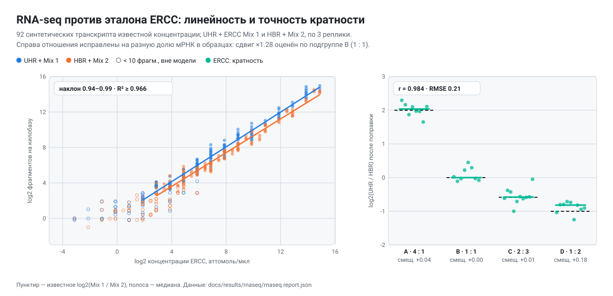

# RNA-seq: STAR и featureCounts против эталона ERCC

WGS-часть проверяется по эталону GIAB, где для каждой позиции известен правильный генотип. Для RNA-seq такого эталона по генам человека нет, зато есть синтетические транскрипты ERCC: 92 последовательности, которые добавляют в образец в известной концентрации. Концентрации охватывают шесть порядков, а две смеси, Mix 1 и Mix 2, отличаются в известное число раз. По ним можно проверить то же, что и в WGS: насколько числа на выходе соответствуют тому, что было на входе.

Пайплайн устроен так же, как WGS: шаги на CWL, программы в Docker, ресурсы меряются внутри шага, отчёт сверяется с порогом качества, а числа в этом тексте — с `evidence.json`.

## Данные

| Что | Откуда | Чем проверено |
|---|---|---|
| Риды: UHR + ERCC Mix 1 и HBR + ERCC Mix 2, по три реплики, 2×100, библиотека с сохранением цепи | учебный набор Griffith et al. (PLoS Comput Biol 2015), риды хромосомы 22 и ERCC; <!--ev:rnaseq_pairs_min-->118571<!--/ev-->–<!--ev:rnaseq_pairs_max-->227392<!--/ev--> пар на образец | sha256 архива; имена ридов R1 и R2 совпадают попарно |
| Эталон: концентрации ERCC в Mix 1 и Mix 2 | таблица Thermo Fisher `cms_095046.txt` | sha256; 92 строки, 4 подгруппы по 23, отношение концентраций сходится с колонкой ожидаемой кратности |
| Геном: chr22 GRCh38 + 92 последовательности ERCC | тот же FASTA GRCh38 no-alt, что у WGS; `ERCC92.zip` Thermo Fisher | длина и MD5 chr22 сверены со словарём GRCh38 Broad Institute |
| Аннотация: GENCODE 50 (Ensembl 116) для chr22 + ERCC92 | `gencode.v50.annotation.gtf.gz` | MD5 из `MD5SUMS` релиза; все контиги аннотации есть в FASTA |

UHR (Universal Human Reference RNA) — смесь РНК десяти линий опухолевых клеток, HBR (Human Brain Reference RNA) — РНК мозга 23 доноров. Это те же коммерческие образцы, на которых работали консорциумы MAQC и SEQC. `make rnaseq-data` собирает всё за пару минут и пишет `data/rnaseq/MANIFEST.sha256`.

## Шаги

| Шаг | Программа | Что делает и почему так |
|---|---|---|
| 1 | fastp 1.4.0 | тот же шаг, что в WGS: адаптеры по перекрытию пары, хвосты poly-G |
| 2 | STAR 2.7.11b, `genomeGenerate` | индекс с аннотированными сплайс-сочленениями; `--genomeSAindexNbases 11`, потому что геном 51 Мб, а не 3 Гб |
| 3 | STAR, выравнивание | параметры ENCODE для длинных РНК из руководства STAR; BAM сразу сортируется по координате; `--quantMode GeneCounts` даёт второй, независимый счётчик |
| 4 | samtools 1.25 | BAM переписывается блоками htslib и индексируется: так он побайтно воспроизводим ([D-20](DEBUGGING.md#d-20)) |
| 5 | featureCounts (Subread 2.1.1) | фрагменты на ген по экзонам GENCODE, `-s 2` для обратной цепи, мультикартированные фрагменты не считаются |
| 6 | отчёт | качество образцов, сверка с ERCC, реплики, маркерные гены, ресурсы, порог качества |

featureCounts собран из исходников вместе со своими тестами: <!--ev:featurecounts_tests_passed-->52<!--/ev--> проверки пройдены, <!--ev:featurecounts_tests_failed-->0<!--/ev--> провалено. STAR взят официальным статическим бинарником; инструкции AVX2 в нём есть, но только в коде, который эта задача не вызывает ([D-17](DEBUGGING.md#d-17)).

## Качество образцов

| Показатель | Значение по шести образцам | Как понимать |
|---|---|---|
| уникально картированные риды | <!--ev:rnaseq_unique_pct_min-->97.0<!--/ev-->–<!--ev:rnaseq_unique_pct_max-->98.7<!--/ev--> % | риды заранее отобраны по chr22 и ERCC, поэтому почти все ложатся |
| фрагменты, отнесённые к генам | <!--ev:rnaseq_assigned_pct_min-->72.5<!--/ev-->–<!--ev:rnaseq_assigned_pct_max-->79.1<!--/ev--> % | остальное — интроны, межгенные участки и мультикартированные фрагменты |
| доля стрендовых отсчётов на обратной цепи | <!--ev:rnaseq_strand_pct_min-->95.2<!--/ev-->–<!--ev:rnaseq_strand_pct_max-->96.6<!--/ev--> % | библиотека с dUTP: рид 1 ложится против цепи транскрипта. Отчёт определяет это сам, порог качества проверяет, что совпало с `-s 2` |
| гены chr22 с ≥ 10 фрагментами | <!--ev:rnaseq_genes_detected_min-->310<!--/ev-->–<!--ev:rnaseq_genes_detected_max-->350<!--/ev--> | |
| доля ERCC среди отнесённых фрагментов | UHR <!--ev:rnaseq_ercc_share_uhr-->64<!--/ev--> %, HBR <!--ev:rnaseq_ercc_share_hbr-->59<!--/ev--> % | в полном транскриптоме ERCC — около процента; здесь гены есть только с одной хромосомы |

Два счётчика на одних и тех же BAM почти не расходятся: по ERCC отсчёты featureCounts и STAR совпадают до фрагмента (<!--ev:rnaseq_counter_ercc_identical-->да<!--/ev--> во всех образцах), по генам сумма различается не больше чем на <!--ev:rnaseq_counter_diff_max-->0.5<!--/ev--> %, корреляция по генам не ниже <!--ev:rnaseq_counter_r_min-->0.997<!--/ev-->. Разница — в правилах для фрагментов на стыке двух генов.

## Линейность

<p align="center">
  <picture>
    <source media="(prefers-color-scheme: dark)" srcset="assets/ercc-dark.svg">
    
  </picture>
</p>

Если метод линеен, число фрагментов на килобазу транскрипта пропорционально числу молекул, и в логарифмах наклон прямой равен 1. В каждом образце прямая строится по ERCC, у которых не меньше 10 фрагментов: ниже пуассоновский шум больше 30 %. Интервал наклона — бутстреп по транскриптам, 2 000 повторов с фиксированным зерном.

| Показатель | Значение |
|---|---|
| найдено ERCC (≥ 1 фрагмента) | <!--ev:rnaseq_ercc_detected_min-->57<!--/ev-->–<!--ev:rnaseq_ercc_detected_max-->65<!--/ev--> из 92 |
| в линейной модели (≥ 10 фрагментов) | <!--ev:rnaseq_ercc_fitted_min-->38<!--/ev-->–<!--ev:rnaseq_ercc_fitted_max-->46<!--/ev--> |
| наклон | <!--ev:rnaseq_slope_min-->0.94<!--/ev-->–<!--ev:rnaseq_slope_max-->0.99<!--/ev-->; 95 % интервал накрывает 1 у <!--ev:rnaseq_slope_ci_cover_1-->6<!--/ev--> образцов из 6 |
| R² | <!--ev:rnaseq_r2_min-->0.966<!--/ev-->–<!--ev:rnaseq_r2_max-->0.979<!--/ev--> |
| динамический диапазон найденных ERCC | <!--ev:rnaseq_dynamic_range_min-->4.8<!--/ev-->–<!--ev:rnaseq_dynamic_range_max-->5.4<!--/ev--> порядка |
| предел обнаружения: ниже этой концентрации хоть один ERCC пропущен хоть в одной реплике | UHR <!--ev:rnaseq_lod_uhr-->29.3<!--/ev--> аттомоль/мкл, HBR <!--ev:rnaseq_lod_hbr-->87.9<!--/ev--> аттомоль/мкл |

В HBR предел выше, потому что библиотеки HBR меньше: в них меньше пар ридов, чем в любой реплике UHR.

## Точность кратности

Для каждого ERCC, у которого не меньше 10 фрагментов в каждой из шести реплик, считается log2(UHR / HBR) после нормировки на число фрагментов генов. Такая нормировка сдвигает все отношения ERCC на одну и ту же величину: ERCC добавляют пропорционально общей РНК, а доля мРНК в UHR и HBR разная. Сдвиг оценивается по подгруппе B, где смеси одинаковы, и вычитается. Здесь он равен ×<!--ev:rnaseq_fc_offset-->1.28<!--/ev--> (log2 = <!--ev:rnaseq_fc_offset_log2-->0.35<!--/ev-->). Поэтому смещение подгруппы B равно нулю по построению, а её разброс показывает шум самого измерения.

| Подгруппа | Mix 1 : Mix 2 | ERCC в расчёте | ожидается, log2 | медиана, log2 | смещение | RMSE |
|---|---|---|---|---|---|---|
| A | 4 : 1 | <!--ev:rnaseq_fc_n_A-->8<!--/ev--> | <!--ev:rnaseq_fc_expected_A-->2.00<!--/ev--> | <!--ev:rnaseq_fc_median_A-->2.04<!--/ev--> | <!--ev:rnaseq_fc_bias_A-->+0.04<!--/ev--> | <!--ev:rnaseq_fc_rmse_A-->0.19<!--/ev--> |
| B | 1 : 1 | <!--ev:rnaseq_fc_n_B-->8<!--/ev--> | <!--ev:rnaseq_fc_expected_B-->0.00<!--/ev--> | <!--ev:rnaseq_fc_median_B-->0.00<!--/ev--> | <!--ev:rnaseq_fc_bias_B-->+0.00<!--/ev--> | <!--ev:rnaseq_fc_rmse_B-->0.21<!--/ev--> |
| C | 2 : 3 | <!--ev:rnaseq_fc_n_C-->10<!--/ev--> | <!--ev:rnaseq_fc_expected_C-->-0.58<!--/ev--> | <!--ev:rnaseq_fc_median_C-->-0.58<!--/ev--> | <!--ev:rnaseq_fc_bias_C-->+0.01<!--/ev--> | <!--ev:rnaseq_fc_rmse_C-->0.23<!--/ev--> |
| D | 1 : 2 | <!--ev:rnaseq_fc_n_D-->9<!--/ev--> | <!--ev:rnaseq_fc_expected_D-->-1.00<!--/ev--> | <!--ev:rnaseq_fc_median_D-->-0.82<!--/ev--> | <!--ev:rnaseq_fc_bias_D-->+0.18<!--/ev--> | <!--ev:rnaseq_fc_rmse_D-->0.19<!--/ev--> |

Всего <!--ev:rnaseq_fc_n-->35<!--/ev--> ERCC, корреляция с ожидаемым <!--ev:rnaseq_fc_pearson-->0.984<!--/ev-->, RMSE <!--ev:rnaseq_fc_rmse-->0.21<!--/ev--> в log2. Кратности 4 : 1 и 2 : 3 измерены почти без смещения. В подгруппе D отношение получилось <!--ev:rnaseq_fc_ratio_D-->0.57<!--/ev--> вместо 0.5: изменение недооценено. При девяти транскриптах нельзя сказать, систематика это или шум, — для этого нужна более глубокая библиотека.

## Реплики и биология образцов

По <!--ev:rnaseq_rep_genes-->265<!--/ev--> генам, у которых не меньше 10 фрагментов в каждом образце, реплики одной группы коррелируют не слабее <!--ev:rnaseq_rep_within_min-->0.980<!--/ev--> (log2 CPM), а UHR с HBR — не сильнее <!--ev:rnaseq_rep_between_max-->0.536<!--/ev-->. Сначала гены отбирались по CPM ≥ 1, и корреляция внутри групп вышла 0.80: при маленькой библиотеке такой порог пропускает гены с одним-двумя ридами ([D-22](DEBUGGING.md#d-22)).

Восемь генов chr22 выбраны заранее, до прогона, по известной биологии образцов: нейронные должны быть выше в мозге, гены репликации ДНК и раково-тестикулярный антиген — в опухолевых линиях. Все <!--ev:rnaseq_markers-->8/8<!--/ev--> изменились в ожидаемую сторону.

| Ген | Что это | Ожидается выше | log2(UHR / HBR) |
|---|---|---|---|
| *NEFH* | тяжёлая цепь нейрофиламента | HBR | <!--ev:rnaseq_marker_nefh_lfc-->-3.6<!--/ev--> |
| *SYN3* | синапсин III | HBR | <!--ev:rnaseq_marker_syn3_lfc-->-3.7<!--/ev--> |
| *CACNG2* | старгазин, субъединица AMPA-рецепторов | HBR | <!--ev:rnaseq_marker_cacng2_lfc-->-10.2<!--/ev--> |
| *SEPTIN3* | септин 3, нейроны | HBR | <!--ev:rnaseq_marker_septin3_lfc-->-4.4<!--/ev--> |
| *MCM5* | лицензирование репликации ДНК | UHR | <!--ev:rnaseq_marker_mcm5_lfc-->3.4<!--/ev--> |
| *CDC45* | инициация репликации | UHR | <!--ev:rnaseq_marker_cdc45_lfc-->8.4<!--/ev--> |
| *CHEK2* | контрольная точка клеточного цикла | UHR | <!--ev:rnaseq_marker_chek2_lfc-->5.0<!--/ev--> |
| *PRAME* | раково-тестикулярный антиген | UHR | <!--ev:rnaseq_marker_prame_lfc-->13.5<!--/ev--> |

Это не тест дифференциальной экспрессии, а проверка, что образцы не перепутаны и счётчик работает по нужной цепи. При ошибке в цепи или в подписях образцов маркеры разошлись бы первыми.

## Воспроизводимость

| Сравнение | Матрица счётов | Записи BAM | Числа отчёта | Байты BAM | Отчёт |
|---|---|---|---|---|---|
| 4 потока против 2 | <!--ev:rnaseq_repro_threads_4_vs_2_counts-->да<!--/ev--> | <!--ev:rnaseq_repro_threads_4_vs_2_bam_records-->да<!--/ev--> | <!--ev:rnaseq_repro_threads_4_vs_2_report-->да<!--/ev--> | <!--ev:rnaseq_repro_threads_4_vs_2_bam_bytes-->нет<!--/ev-->: в заголовке `--runThreadN N` | [threads_4_vs_2](results/rnaseq/reproducibility_threads_4_vs_2.md) |
| повторный запуск, 4 потока | <!--ev:rnaseq_repro_same_threads_counts-->да<!--/ev--> | <!--ev:rnaseq_repro_same_threads_bam_records-->да<!--/ev--> | <!--ev:rnaseq_repro_same_threads_report-->да<!--/ev--> | <!--ev:rnaseq_repro_same_threads_bam_bytes-->да<!--/ev--> | [same_threads](results/rnaseq/reproducibility_same_threads.md) |

Сравниваются также таблица и сводка featureCounts, счёт STAR по генам и сплайс-сочленения. Порядок записей в BAM от числа потоков не зависит: STAR сортирует по позиции и номеру рида во входном файле. Байты BAM при повторе совпали только после того, как BAM стал переписываться блоками htslib ([D-20](DEBUGGING.md#d-20)). Пик длины вставки из отчёта fastp в отчёт RNA-seq не попадает: fastp 1.4.0 считает его только в одном рабочем потоке, и значение меняется с числом потоков, хотя сами риды одинаковые ([D-23](DEBUGGING.md#d-23)).

Проверку делает `scripts/check_rnaseq_reproducibility.sh`.

## Ресурсы

Индекс STAR строится <!--ev:rnaseq_index_wall_s-->20<!--/ev--> с при пике памяти <!--ev:rnaseq_index_peak_gb-->1.2<!--/ev--> ГБ, выравнивание одного образца занимает до <!--ev:rnaseq_align_wall_max_s-->5.7<!--/ev--> с и <!--ev:rnaseq_align_peak_gb_max-->1.1<!--/ev--> ГБ. Все шаги вместе — <!--ev:rnaseq_total_wall_s-->66<!--/ev--> с и <!--ev:rnaseq_total_cpu_s-->126<!--/ev--> CPU-секунд на 4 потоках. Для полного генома человека STAR, по его руководству, нужно около 32 ГБ памяти; на кластере индекс строят один раз и подают готовым входом, как индекс bwa-mem2.

## Порог качества

`config/rnaseq_qc_thresholds.json` ловит регрессии, а не утверждает качество: пороги стоят ниже того, что измерено на эталонном прогоне. Проверяется уникальное картирование, доля фрагментов в генах, цепь библиотеки (и то, что выведенная цепь совпала с настройкой), R² и наклон по ERCC, смещение кратности по подгруппам и корреляция реплик. Эталонный прогон проходит <!--ev:rnaseq_qc_checks-->9/9<!--/ev--> проверок.

## Ограничения

- Риды отобраны по выравниванию на chr22 и ERCC ещё на GRCh37 и прорежены. Поэтому CPM считаются относительно генов одной хромосомы, а доля ERCC намного выше, чем в полном транскриптоме. Сами отношения и линейность от этого не зависят.
- Один набор данных: HiSeq 2500, 2014 год, около полумиллиона пар на группу. На NovaSeq и более глубоких библиотеках шум ниже, а предел обнаружения другой.
- ERCC проверяют количественную часть пайплайна, но не сплайсинг: у синтетических транскриптов один экзон. Сплайс-сочленения проверены косвенно: не меньше <!--ev:rnaseq_splices_annotated_pct_min-->99.4<!--/ev--> % найденных STAR сочленений есть в аннотации GENCODE ([журналы STAR](results/rnaseq/star/)).
- Здесь нет теста дифференциальной экспрессии и квантования на уровне транскриптов (Salmon). Это следующий шаг ([ROADMAP](ROADMAP.md)).

## Запуск

```bash
make rnaseq-image   # STAR и featureCounts (из исходников, с тестами)
```

```bash
make rnaseq-data    # риды, эталон ERCC, chr22 + ERCC92, GENCODE 50
```

```bash
make rnaseq         # пайплайн, отчёт и порог качества -> results/rnaseq/rnaseq.report.md
```

```bash
scripts/check_rnaseq_reproducibility.sh   # два прогона (4 и 2 потока) и сравнение
```

Свои образцы задаются в `cwl/jobs/rnaseq-uhr-hbr.yml`: имена, группы, смеси ERCC, пары FASTQ, референс и аннотация. Если ERCC в образцах нет, сверка с ними просто пропускается, а качество образцов и счёты считаются как обычно.

## Источники

- Jiang L. et al. Synthetic spike-in standards for RNA-seq experiments. Genome Res. 2011;21:1543–1551.
- Munro S. A. et al. Assessing technical performance in differential gene expression experiments with external spike-in RNA control ratio mixtures. Nat Commun. 2014;5:5125.
- SEQC/MAQC-III Consortium. A comprehensive assessment of RNA-seq accuracy, reproducibility and information content by the Sequencing Quality Control Consortium. Nat Biotechnol. 2014;32:903–914.
- Griffith M. et al. Informatics for RNA sequencing: a web resource for analysis on the cloud. PLoS Comput Biol. 2015;11:e1004393.
- Dobin A. et al. STAR: ultrafast universal RNA-seq aligner. Bioinformatics. 2013;29:15–21.
- Liao Y., Smyth G. K., Shi W. featureCounts: an efficient general purpose program for assigning sequence reads to genomic features. Bioinformatics. 2014;30:923–930.
- Frankish A. et al. GENCODE: reference annotation for the human and mouse genomes in 2023. Nucleic Acids Res. 2023;51:D942–D949.
